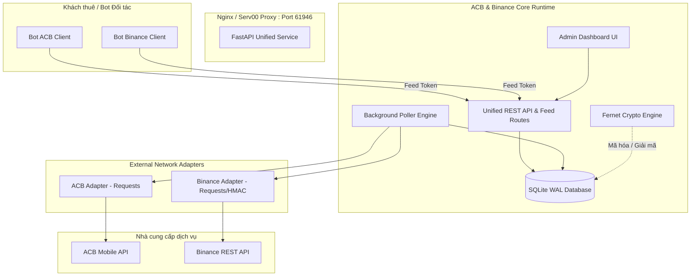

# Kế hoạch Tích hợp Binance Gateway vào ACB API Service

Tài liệu này đánh giá module [`binance_gateway`](../binance_gateway/README.md) và thiết lập lộ trình tích hợp tính năng Binance (Pay, BSC, TRX) vào hệ thống [`acb_api_service_standalone`](README.md), tạo thành một **Unified Payment/Banking Gateway** đa kênh duy nhất, tối ưu tài nguyên cho hạ tầng Serv00.

---

## 1. Đánh giá Hiện trạng `binance_gateway`

Module [`binance_gateway`](../binance_gateway/README.md) là một gateway độc lập được thiết kế tối giản:

### Ưu điểm
- **Chức năng rõ ràng:** Hỗ trợ 3 luồng giao dịch tiền mã hóa chính:
  - **Binance Pay:** `/sapi/v1/pay/transactions` (lịch sử nhận tiền Binance Pay).
  - **BSC (BEP20 USDT):** `/sapi/v1/capital/deposit/hisrec` (lịch sử nạp USDT mạng BSC).
  - **TRX (TRC20 TRX/USDT):** `/sapi/v1/capital/deposit/hisrec` (lịch sử nạp coin TRX mạng TRON).
- **Đồng bộ thời gian:** Có hàm `sync_time()` giải quyết vấn đề lệch đồng hồ (time drift) giữa VPS và Binance server (`/api/v3/time`).
- **Chuẩn hóa dữ liệu:** Đã có hàm `_normalize_pay` và `_normalize_deposit` giúp đồng nhất cấu trúc dữ liệu trả về cho client.

### Nhược điểm & Rủi ro khi vận hành độc lập
1. **Lỗ hổng bảo mật lưu trữ:** API Key và API Secret của các đối tác/khách hàng được lưu dưới dạng **plaintext** trong file [`tenants.json`](../binance_gateway/config.py:35). Nếu server bị lộ file, toàn bộ khóa Binance có nguy cơ bị chiếm dụng.
2. **Không có giao diện quản trị (Admin UI):** Muốn thêm, sửa, tắt khách hàng (tenant) phải SSH vào server sửa file JSON thủ công rồi khởi động lại tiến trình.
3. **Lưu trữ tạm bợ (In-memory & Snapshot Cache):** Lưu dữ liệu vào [`data/cache.json`](../binance_gateway/app.py:42) dạng ghi đè snapshot. Không có cơ chế deduplicate giao dịch theo thời gian, không có database truy vấn có index cursor, dễ mất lịch sử giao dịch khi cache bị lỗi hoặc khởi động lại.
4. **Lãng phí tài nguyên Serv00 (RAM/Process/Port):**
   - Nếu chạy riêng biệt: Phải mở thêm 1 port TCP (`devil port add tcp`), cấu hình thêm 1 proxy domain, chạy thêm 1 tiến trình Uvicorn + Python runtime (~60-80 MB RAM).
   - Thêm dependency `aiohttp==3.9.5` phải build/cài đặt thêm trên môi trường FreeBSD.

---

## 2. Chiến lược Tích hợp Hợp nhất (Unified Gateway)

Thay vì chạy 2 service song song, phương án tối ưu nhất là: **Hợp nhất `binance_gateway` vào `acb_api_service`**, tận dụng toàn bộ hạ tầng sẵn có:

| Thành phần | Trước khi tích hợp | Sau khi tích hợp (Hợp nhất) |
|---|---|---|
| **Mô hình triển khai** | 2 service riêng, 2 port, 2 domain | **1 service duy nhất** trên port 61946, domain `doni.serv00.net` |
| **Tiêu tốn RAM Serv00** | ~180-200 MB (ACB + Binance) | **~115-125 MB** (chạy chung runtime hiện tại) |
| **Bảo mật Credentials** | Plaintext trong JSON | **Mã hóa Fernet AES-128-CBC** trong SQLite (`credential_ciphertext`) |
| **Quản trị Tenants** | Sửa file JSON thủ công | **Admin Dashboard Web UI** trực quan (thêm/sửa/xoay key/test connection) |
| **Lưu trữ Giao dịch** | Cache snapshot JSON | **SQLite WAL** có deduplication `UNIQUE(customer_id, external_id)`, cursor pagination |
| **Thư viện HTTP** | `aiohttp` + `requests` | **Chỉ dùng `requests` + standard library (`hashlib`, `hmac`)** |

---

## 3. Kiến trúc Hệ thống Sau Tích hợp

---

## 4. Chi tiết Kỹ thuật Cần Thay đổi

### 4.1. Mở rộng Database Schema ([`acb_api_service/core.py`](acb_api_service/core.py:170))
- Bảng `customers`:
  - Thêm trường `provider TEXT NOT NULL DEFAULT 'acb'` (hỗ trợ `'acb'`, `'binance'`).
  - Thêm trường `channel_type TEXT DEFAULT NULL` (cho Binance: `'pay'`, `'bsc'`, `'trx'`, hoặc `'all'`).
  - Cho phép `account_number` linh hoạt (với Binance có thể là Account ID hoặc Tenant Tag).
- Bảng `transactions`:
  - Đổi kiểu `amount` từ số nguyên cứng sang hỗ trợ số thực hoặc thêm cột `currency TEXT DEFAULT 'VND'`:
    - ACB: `currency = 'VND'`, `amount` là số tiền VND.
    - Binance: `currency = 'USDT'` hoặc `'TRX'`, lưu giá trị thập phân chính xác (hoặc chuỗi thập phân).
  - Thêm trường `extra_meta TEXT DEFAULT '{}'` để lưu các thông tin đặc thù tiền điện tử: `txId`, `address`, `network`, `orderId`, `payerInfo`.

### 4.2. Xây dựng `BinanceAdapter` ([`acb_api_service/binance_adapter.py`](acb_api_service/binance_adapter.py))
- Kế thừa triết lý đồng bộ và cô lập của [`ACBAdapter`](acb_api_service/acb_adapter.py:21).
- Sử dụng `requests.Session` (không cần thêm `aiohttp`).
- Ký HMAC-SHA256 chuẩn Binance bằng `hashlib` và `hmac`.
- Tích hợp logic `sync_time()` để bù lệch thời gian server.
- Hàm chuẩn `fetch_transactions(kind)` lấy dữ liệu từ:
  - `/sapi/v1/pay/transactions`
  - `/sapi/v1/capital/deposit/hisrec`

### 4.3. Cải tiến Worker ([`acb_api_service/worker.py`](acb_api_service/worker.py:49))
- Khi [`Poller.sync_customer()`](acb_api_service/worker.py:69) thực thi:
  - Kiểm tra `customer['provider']`.
  - Nếu là `acb`: Khởi tạo và gọi [`ACBAdapter`](acb_api_service/acb_adapter.py:21).
  - Nếu là `binance`: Khởi tạo và gọi `BinanceAdapter`.
- Tự động chuẩn hóa và chèn vào bảng `transactions` chung, kích hoạt deduplication an toàn chống trùng lặp dữ liệu.

### 4.4. Tương thích API Endpoints ([`acb_api_service/app.py`](acb_api_service/app.py:22))
1. **Endpoint Thống nhất:**
   - `GET /api/v1/feed?token=...` hoạt động cho cả ACB và Binance dựa trên token của khách hàng.
   - `GET /api/v1/transactions` hoạt động chung qua `X-API-Key`.
2. **Endpoint Tương thích Cũ cho Binance Client:**
   - Để khách hàng đang dùng `binance_gateway` không cần sửa code bot, giữ tương thích:
     - `GET /api/v1/{tenant_id}/{kind}/feed?token=...`
     - `GET /api/v1/{tenant_id}/status?token=...`
     - Route này sẽ tra cứu `customer` theo `account_number = tenant_id` và xác thực token, trả về đúng định dạng JSON mà bot Binance đang mong đợi.

### 4.5. Nâng cấp Giao diện Quản trị Admin ([`acb_api_service/templates/`](acb_api_service/templates/))
- Bổ sung tùy chọn khi tạo Customer:
  - Chọn Loại: **Ngân hàng ACB** hoặc **Binance Gateway**.
  - Nếu chọn Binance: Form chuyển sang nhập `API Key`, `API Secret`, chọn kênh (`Binance Pay`, `BSC USDT`, `TRX Deposit`).
  - Hỗ trợ nút `Test Connection` gọi thử `BinanceAdapter` để kiểm tra API Key/Secret ngay trên web.

---

## 5. Kế hoạch Triển khai Từng Bước

1. **Giai đoạn 1: Thiết kế & Xây dựng Adapter Binance**
   - Viết [`acb_api_service/binance_adapter.py`](acb_api_service/binance_adapter.py) sử dụng `requests`.
   - Viết unit tests độc lập cho signature HMAC, time sync, normalization trong [`tests/test_binance_adapter.py`](tests/test_binance_adapter.py).

2. **Giai đoạn 2: Cập nhật Core & Database Migration**
   - Bổ sung các cột mới vào `SCHEMA` và hàm migration gia tăng (additive migration) trong [`acb_api_service/core.py`](acb_api_service/core.py:170).
   - Đảm bảo database hiện tại trên production Serv00 không bị gián đoạn hay mất dữ liệu khi cập nhật schema.

3. **Giai đoạn 3: Tích hợp Worker & App Routes**
   - Nâng cấp [`Poller`](acb_api_service/worker.py:49) để phân nhánh adapter theo `provider`.
   - Bổ sung router tương thích backward `/api/v1/{tenant_id}/{kind}/feed` trong [`acb_api_service/app.py`](acb_api_service/app.py:22).
   - Nâng cấp template HTML trong [`templates/dashboard.html`](acb_api_service/templates/dashboard.html) và [`templates/customer.html`](acb_api_service/templates/customer.html).

4. **Giai đoạn 4: Kiểm thử Toàn diện (Local)**
   - Chạy toàn bộ unit tests hiện tại (đảm bảo 14/14 test cũ vẫn pass 100%).
   - Bổ sung tests mới cho luồng Binance (tạo customer Binance, sync mock, check feed API, backward compatibility route).

5. **Giai đoạn 5: Triển khai Lên Serv00 (Production)**
   - Đóng gói và cập nhật mã nguồn lên `/home/doni/acb_api_service`.
   - Khởi động lại service bằng [`start.sh`](start.sh).
   - Kiểm tra log, tài nguyên RAM và xác nhận health endpoints.
