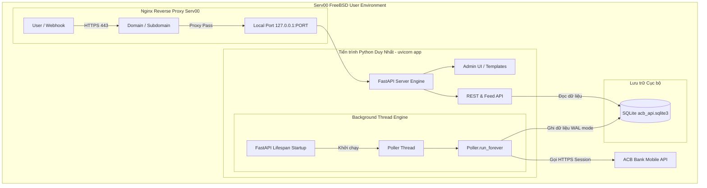

# Kế hoạch Tối ưu hóa và Triển khai ACB API Service lên Serv00 (FreeBSD)

Tài liệu này phân tích chi tiết hiện trạng mã nguồn, đánh giá gói phụ thuộc trong [`requirements.txt`](../requirements.txt), đưa ra các cải tiến kiến trúc phù hợp với môi trường shared hosting Serv00, cùng quy trình SSH dọn dẹp máy chủ và triển khai hoàn chỉnh.

---

## 1. Đánh giá Hiện trạng & Tối ưu Gói Phụ thuộc (`requirements.txt`)

### 1.1. Bảng đối chiếu thực tế từng thư viện

| Tên thư viện | Phiên bản hiện tại | Vai trò trong dự án | Tình trạng sử dụng thực tế | Đề xuất tối ưu hóa cho Serv00 |
| :--- | :--- | :--- | :--- | :--- |
| `fastapi` | `0.111.0` | Web routing, API endpoint, middleware | Đang dùng tại [`acb_api_service/app.py`](../acb_api_service/app.py:11) | **Giữ lại**: Chuẩn RESTful, xử lý validation và swagger tự động. |
| `uvicorn` | `0.30.1` | Máy chủ ASGI | Chạy app FastAPI | **Giữ lại (bản pure)**: Lưu ý KHÔNG cài gói `uvicorn[standard]` để tránh compile `uvloop` hay `httptools` bằng C/Rust dễ gây lỗi trên FreeBSD. |
| `requests` | `2.32.5` | HTTP Client gọi tới ACB | Đang dùng tại [`ACBAdapter`](../acb_api_service/acb_adapter.py:10) | **Giữ lại**: Hoạt động đồng bộ bên trong thread pool, ổn định, nhẹ, tương thích 100% với logic hiện có. |
| `cryptography`| `>=42.0.0` | Fernet mã hóa dữ liệu nhạy cảm | Đang dùng tại [`Crypto`](../acb_api_service/core.py:19) | **Giữ lại**: Bắt buộc để mã hóa an toàn mật khẩu ACB trong SQLite. Cần dùng wheel có sẵn hoặc gói FreeBSD. |
| `Jinja2` | `3.1.6` | Template engine cho Admin UI | Đang dùng render HTML tại [`acb_api_service/app.py`](../acb_api_service/app.py:13) | **Giữ lại**: Rất nhẹ, cần thiết cho giao diện quản trị Admin. |
| `python-multipart`| `0.0.9` | Parse HTTP Form data | Đang dùng nhận dữ liệu form tại [`acb_api_service/app.py`](../acb_api_service/app.py:11) | **Giữ lại**: Cần cho chức năng đăng nhập và cập nhật khách hàng qua form web. |
| `httpx` | `>=0.24.0` | Async/sync HTTP Client | **KHÔNG DÙNG TRONG RUNTIME** (chỉ có trong [`tests/test_acb_api_service.py`](../tests/test_acb_api_service.py:12)) | **LOẠI BỎ KHỎI PRODUCTION**: Chỉ đưa vào `requirements-dev.txt`. Việc bỏ `httpx` giúp giảm tải cài đặt, tiết kiệm bộ nhớ trên Serv00. |

### 1.2. Đề xuất file [`requirements.txt`](../requirements.txt) tinh gọn (Production)
```text
fastapi==0.111.0
uvicorn==0.30.1
requests==2.32.5
cryptography>=42.0.0
Jinja2==3.1.6
python-multipart==0.0.9
```

---

## 2. Đặc thù của Hosting Serv00 & Các Điểm nghẽn Cần Khắc phục

Serv00 là nền tảng FreeBSD Shared Hosting miễn phí rất mạnh nhưng có các hạn chế kỹ thuật khắt khe:

1. **Không có quyền Root / Sudo & Không có `systemd`**:
   - Các file cấu hình trong [`deploy/acb-api-web.service`](../deploy/acb-api-web.service), [`deploy/acb-api-worker.service`](../deploy/acb-api-worker.service) và [`deploy/acb-api-nginx.conf`](../deploy/acb-api-nginx.conf) không thể chạy trực tiếp.
   - Phải sử dụng công cụ điều khiển của Serv00 (`devil`), trình quản lý tiến trình cấp người dùng (`pm2` hoặc wrapper shell script kết hợp `crontab`).
2. **Giới hạn RAM (512MB RAM tổng cho toàn bộ user)**:
   - Mô hình cũ chạy 2 tiến trình độc lập (`uvicorn` ~45MB RAM + `worker.py` ~45MB RAM) sẽ ngốn gần 100MB RAM.
   - Nếu có các tiến trình chạy nền khác, tài khoản sẽ rất dễ chạm ngưỡng 512MB và bị hệ thống tự động OOM Kill.
3. **Chính sách diệt tiến trình nền (Process Reaper)**:
   - Serv00 sẽ kill các tiến trình nền chạy liên tục nếu người dùng chưa kích hoạt cờ chạy chương trình ngoài (`devil binexec on`).
   - Cần có kịch bản Watchdog kiểm tra định kỳ mỗi 1 - 2 phút qua Crontab để khởi động lại nếu tiến trình bị kill.
4. **Cơ chế Mạng & Cổng dịch vụ (Port Management)**:
   - Người dùng không được tùy ý lắng nghe trên các cổng tự do mà phải đăng ký trước qua lệnh: `devil port add tcp`.
   - Để expose web ra ngoài kèm chứng chỉ SSL miễn phí, sử dụng tính năng Domain Proxy của Devil: trỏ subdomain về cổng TCP nội bộ.
5. **Đường dẫn cứng `/opt/acb-api`**:
   - Hiện tại [`.env.example`](../.env.example) sử dụng đường dẫn Linux `/opt/acb-api/...`.
   - Trên Serv00, thư mục của bạn là `/usr/home/<username>/...` hoặc relative path `./data/...`.

---

## 3. Kiến trúc Cải tiến: Single-Process (Embedded Worker)

Để tiết kiệm tối đa RAM và giảm số lượng tiến trình quản lý trên Serv00, kiến trúc được tối ưu hóa như sau:



### Ưu điểm vượt trội:
- **Tiết kiệm 50% RAM**: Chỉ duy trì 1 tiến trình Python duy nhất (~40MB RAM).
- **Quản lý đơn giản**: Chỉ cần 1 dòng lệnh khởi chạy hoặc 1 dòng trong script watchdog.
- **SQLite WAL Mode**: Bật `PRAGMA journal_mode=WAL;` và `PRAGMA busy_timeout=15000;` tại [`Database.connect()`](../acb_api_service/core.py:217) giúp các thao tác đọc từ API và ghi từ Poller diễn ra đồng thời mà không bị khóa đĩa.

---

## 4. Kế hoạch Dọn dẹp Tài khoản Serv00 qua SSH

Trước khi triển khai, cần SSH vào tài khoản Serv00 để kiểm tra và dọn dẹp các project rác:

1. **Khảo sát trạng thái tài khoản**:
   - Xem bộ nhớ và tiến trình đang chạy: `devil status`, `ps aux | grep $USER`.
   - Kiểm tra các cổng TCP đã mở: `devil port list`.
   - Kiểm tra danh sách website/proxy đã cấu hình: `devil www list`.
   - Kiểm tra crontab hiện tại: `crontab -l`.
2. **Dọn dẹp triệt để**:
   - Dừng và kill toàn bộ các tiến trình cũ không dùng đến.
   - Xóa các website, domain proxy cũ không sử dụng: `devil www del <domain>`.
   - Xóa các port TCP cũ không dùng: `devil port del tcp <port>`.
   - Xóa bỏ các cronjob cũ trong `crontab -r`.
   - Dọn dẹp thư mục rác trong `~/public_html/` hoặc `~/domains/` và các thư mục mã nguồn cũ.
3. **Cấu hình môi trường nền tảng**:
   - Bật quyền thực thi nhị phân cho user: `devil binexec on`.
   - Kiểm tra phiên bản Python có sẵn trên máy chủ: `python3 -V` (thường là Python 3.10 hoặc 3.11).
   - Đăng ký một cổng TCP mới cho ACB API: `devil port add tcp`.

---

## 5. Quy trình Triển khai Dự án lên Serv00

### Bước 1: Điều chỉnh Mã nguồn Cục bộ
1. Cập nhật [`requirements.txt`](../requirements.txt): Loại bỏ `httpx`, đưa vào `requirements-dev.txt`.
2. Thêm hỗ trợ `ACB_API_EMBEDDED_WORKER=true` vào [`acb_api_service/app.py`](../acb_api_service/app.py) bằng cơ chế FastAPI lifespan context manager.
3. Cập nhật `PRAGMA journal_mode=WAL;` trong [`Database.connect()`](../acb_api_service/core.py:217).
4. Cập nhật [`.env.example`](../.env.example) dùng đường dẫn mặc định cục bộ `data/acb_api/acb_api.sqlite3`.

### Bước 2: Tạo bộ kịch bản triển khai riêng cho Serv00
Tạo thư mục `deploy/serv00/` gồm các file:
- `start.sh`: Kịch bản nạp `.env` và khởi chạy Uvicorn với port nội bộ.
- `watchdog.sh`: Kịch bản kiểm tra xem tiến trình Uvicorn còn chạy không, nếu tắt sẽ tự khởi chạy lại và ghi log.
- `setup.sh`: Kịch bản chạy trên Serv00 để tạo virtualenv, cài dependencies, tạo thư mục `data/acb_api` và chạy [`bootstrap.py`](../acb_api_service/bootstrap.py).

### Bước 3: Đồng bộ mã nguồn lên Serv00
- Đẩy code lên Git hoặc rsync/scp trực tiếp lên thư mục `~/acb_api_service/` trên Serv00.

### Bước 4: Cấu hình Tên miền và Proxy trên Serv00
1. Thêm domain hoặc subdomain trong Devil:
   ```bash
   devil www add your-domain.serv00.net proxy localhost <PORT_DA_DANG_KY>
   ```
2. Cấp chứng chỉ SSL tự động miễn phí qua Devil:
   ```bash
   devil ssl your-domain.serv00.net letsencrypt
   ```

### Bước 5: Thiết lập Crontab Duy trì Dịch vụ (Watchdog)
Thêm cronjob tự động kiểm tra mỗi phút:
```cron
* * * * * /usr/home/<username>/acb_api_service/deploy/serv00/watchdog.sh >/dev/null 2>&1
```

---

## 6. Phân bổ Công việc Tiếp theo

- [x] Tạo tài liệu kiến trúc và kế hoạch triển khai chi tiết (`plans/serv00_optimization_and_deployment_plan.md`).
- [ ] Chuyển sang **Code Mode** để:
  1. Yêu cầu thông tin SSH từ người dùng (Host, Port, Username, Password/SSH Key).
  2. SSH vào Serv00 khảo sát tài nguyên, dọn sạch tiến trình và project cũ.
  3. Cập nhật code tối ưu (Single-process, SQLite WAL, requirements.txt, bộ script Serv00).
  4. Đẩy mã nguồn lên Serv00, cấu hình cronjob và domain proxy hoàn chỉnh.
